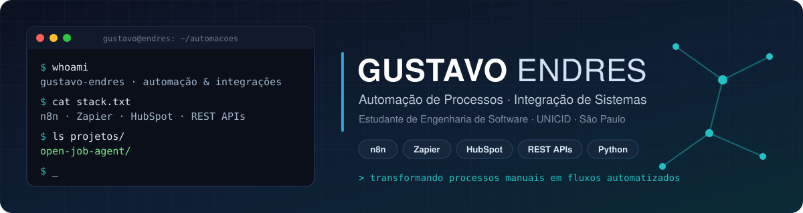

 

---

## 👋 Sobre mim

- 🎓 Estudante de **Engenharia de Software** na **UNICID** (Universidade Cidade de São Paulo).
- ⚙️ Mais de dois anos em **operações técnicas** para empresas sediadas nos Estados Unidos, transformando processos manuais em fluxos automatizados.
- 🔗 Trabalho com **n8n, Zapier, HubSpot, REST APIs e webhooks** para conectar sistemas, tratar dados e reduzir trabalho repetitivo.
- 🎯 Busco oportunidades em **automação de processos, integração de sistemas e operações técnicas**.
- 📍 São Paulo, Brasil.

## 🛠️ Tecnologias e ferramentas

**Automação e integração**

**Linguagens**

**Qualidade e entrega**

## 🚀 Projeto em destaque

### 🔎 [Open Job Agent](https://github.com/gustavo-endres/open-job-agent)

Base open source em Python para buscar, deduplicar e pontuar vagas de APIs públicas (Greenhouse, Lever e Ashby).

| | |
|---|---|
| **Fluxo** | coleta → normalização → deduplicação → pontuação de 0 a 100 → relatório JSON |
| **Demonstração** | roda pelo GitHub Actions, com vagas fictícias e sem credenciais |
| **Qualidade** | 27 testes automatizados com pytest |
| **Licença** | MIT |

> O projeto organiza e pontua oportunidades para revisão humana; ele não envia candidaturas automaticamente.

## 📚 Aprendendo agora

- Fundamentos de Engenharia de Software na graduação
- Python, ciência de dados e IA generativa aplicada a automações
- Testes automatizados e documentação de projetos

## 📫 Contato

Vamos conversar sobre automação e integrações: [linkedin.com/in/gustavoendres](https://www.linkedin.com/in/gustavoendres/)

“Transformando processos manuais em fluxos automatizados.”

